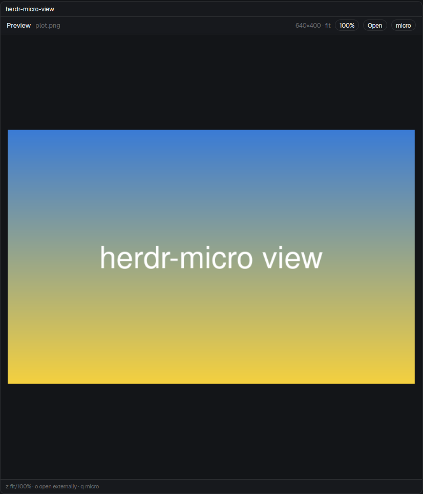

# herdr-micro

A mod for the [Herdr app](https://herdr.dev) that puts the
[micro](https://micro-editor.github.io) editor beside your agents. It adds:

- a micro per tab, with a file tree beside it (`ctrl-alt-m`);
- an image and PDF viewer that takes micro's place;
- a picker that finds any file in the repo (`cmd-shift-o`, Super+Shift+O on
  Linux).
- **herdr-latex** (`ctrl-alt-l`): a LaTeX pane beside micro. `latexmk`
  rebuilds on every save, and the pane shows the PDF, the problems (click
  one to jump micro to the line), the outline, the word count, and a
  **Fix with agent** button that sends the errors to the tab's agent.



## Install

```sh
git clone https://github.com/tim-devereux/herdr-micro
cd herdr-micro/mods
for m in herdr-micro herdr-micro-pick herdr-micro-view herdr-latex; do
  mkdir -p ~/.config/herdr-app/mods/$m
  cp $m/mod.json ~/.config/herdr-app/mods/$m/   # mod.json first, so it isn't docked
  cp $m/*.js ~/.config/herdr-app/mods/$m/
  herdr-app check ~/.config/herdr-app/mods/$m
done
```

Then add the bindings from `keys.json` to `~/.config/herdr-app/keys.json`.

It needs `micro` and `git` (on each machine whose spaces use it: it works
in remote spaces too). The viewer also needs `pdftoppm` and `pdfinfo`
(poppler) and ImageMagick. herdr-latex needs `latexmk` and a TeX Live with
its fonts (on Fedora: `latexmk texlive-collection-fontsrecommended
texlive-collection-latexrecommended`) on the machine the space is on. See [RECIPE.md](RECIPE.md) for everything it
does.
