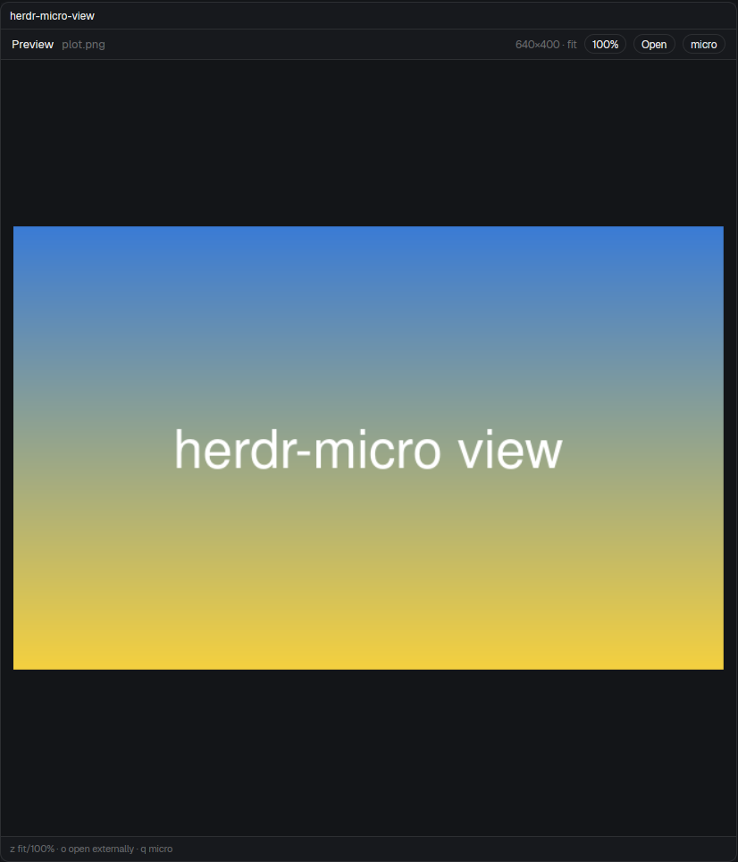

# herdr-micro

The [micro](https://micro-editor.github.io) editor beside your agents in the
Herdr app. One key opens the tab's own micro with a file tree on its right.
Images and PDFs from the tree open in a viewer in micro's place, and a picker
finds any file in the repo.

## Adding it

Copy the three folders in `mods/` to `~/.config/herdr-app/mods/`, then merge
`keys.json` into the person's `keys.json`. Copy each folder's `mod.json`
**before** its `.js` files: a folder that shows up without one is docked into
the layout on screen as a 320px block. Run `herdr-app check` on each folder.

It needs `micro`, `git`, GNU `find` and `stat`, and `sh`. The viewer also
needs `pdftoppm` and `pdfinfo` (poppler) for PDFs, and ImageMagick (`magick`)
for image sizes and TIFF/BMP/ICO/HEIC/AVIF. Its Open button uses `xdg-open`.
It runs those programs and `hc`, and reads files anywhere under the tab's
folder. It uses no network and edits no layout.

## What you see

- **micro pane**: a real micro in a core terminal, as tall as the tab, to the
  right of the tab's panes. The pane header shows its terminal and folder.
- **Tree pane**, right of micro (it starts at half of micro's width; drag the
  divider to resize):
  - a 34px header with "Files" and the root folder's name in `dim`, and
    `~ <name>` in `accent` when the root has moved away from the tab's folder;
  - 26px rows: a chevron (`mods/files/chevron-*.svg`), a folder or file icon
    (`mods/files/*.svg`) in `muted`, the name (dotfiles in `muted`), and a git
    mark: `A`/`U` in `ansi2`, `D` in `ansi1`, `M` in `blocked`, and `•` in
    `dim` on folders with changes;
  - the selected row is `selected` while the tree has the keyboard (`hover`
    otherwise), and the header's bottom border turns `accent`;
  - a footer with the keys in `dim` at 10.5px.
- **Viewer pane** (`herdr-micro-view`), in micro's place:
  - a 34px header: "Preview", the file name in `dim`, then `W×H · fit` or
    `page n / N`, and pill buttons (1px `border`, 11.5px): `100%`/`Fit`
    (images only), `Open`, `micro`;
  - images fitted with 14px around them, or at 100% in a scroll area;
  - PDFs as white pages at the pane's width, 14px apart, in a virtual list
    with a scrollbar; pages not rendered yet show "Page n…" on `surface`;
  - a footer with its keys.
- **Picker** (`herdr-micro-pick`): a 760×460 dialog. It has a 36px `chrome`
  bar with "Open in micro", the root in `dim` and its keys, then a search
  input. Below that, 26px rows: the git mark, the file name, its folder in
  `dim` and its age (`now`, `5m`, `3h`, `2d`).

## How it behaves

Everything works the same in a space on another machine (`hc machine ls`):
micro runs there, and the tree, git marks, picker and viewer read that
machine's files. The viewer fetches images and PDF pages from there, and
`Open` fetches the file and opens it here.

- **ctrl-alt-m** (`mod.open:herdr-micro`) toggles the focused tab's pair.
  - Opening it the first time starts `micro` in the tab's git repo (the
    focused terminal's folder, else the tab's first terminal's folder; the
    repo top, else that folder). micro opens right of the focused pane, then
    the tree opens right of micro, and micro gets the keyboard.
  - Closing it closes the tree and the viewer and parks micro: it keeps
    running with its buffers. Opening it again gives the same micro a pane.
  - One micro per tab. Quitting micro (Ctrl-Q) closes its pane, and the tree
    closes within a second.
  - A parked micro whose tab is gone is killed the next time the key is used.
- **Tree**: click a row, or Enter, `l` or → on it.
  - A folder opens or closes.
  - A file opens in micro (Esc, Ctrl-E, then `open '<path>'`; micro asks to
    save first if its buffer has unsaved changes), and micro gets the
    keyboard.
  - An image or PDF opens the viewer instead.
  - Other keys: `j`/`k` or ↓/↑ move; `g`/`G` first/last row; `h`/← closes
    the folder (or the row's folder, and selects it); Backspace moves the
    root up a folder; `.` makes the row's folder the root; `~` goes back to
    the tab's folder; `H` shows or hides dotfiles (hidden at first); `Z`
    closes every folder; `u` lists again; `q`/Esc gives micro the keyboard.
  - It lists again when anything under the root changes (`watchFolder`;
    when the watch is refused it retries every 5 s). `.git` is never shown.
- **Viewer**: opening a file splits the viewer off micro's pane, then parks
  micro, so the viewer takes micro's place and size.
  - Another image or PDF from the tree or picker replaces the one shown.
  - `q`, Esc or the `micro` button bring micro back where the viewer was and
    close the viewer. Opening a text file from the tree or picker does the
    same, then opens the file.
  - Images: `z` or the button switches between fit and 100%.
  - PDFs: `j`/`n`/↓/Space/PageDown go to the next page, `k`/`p`/↑/PageUp the
    previous, `g`/`G` the first/last. Pages render at 1600px wide, one at a
    time: the current page and the next two first, then the rest in order.
  - `o` or `Open` opens the file in the system's app.
  - It reloads when the file's modification time changes (checked every 2 s).
- **cmd-shift-o** (`mod.open:herdr-micro-pick`, Super+Shift+O on Linux)
  opens the picker for the focused tab.
  - It lists git's tracked and untracked files (`find` outside a repo), up
    to 8000, uncommitted changes first, then newest first.
  - Typing filters it: name prefix, then name substring, then path
    substring, then a fuzzy subsequence. ↑/↓ or Ctrl-N/P move, Enter or a
    click opens, Esc closes.
  - Opening a file opens the pair first if it is hidden. Images and PDFs go
    to the viewer.

## Built from

- **`herdr-micro`** (`place: none`, `focusable`, overlay popup 1×1, no
  frame). It has three roles, chosen by props:
  - an overlay (no role, from `mod.open`): runs the toggle, then
    `closeOverlay`;
  - `{role: "tree", tab, root}`: the tree pane (`tree.js`);
  - `{role: "pick", place}`: the picker dialog (`pick.js`).

  `micro.js` holds the helpers:
  - micro starts with `hc run --bg --json --cwd <root> --label
    herdr-micro.tab=<tab> --label herdr-micro.root=<root> -- micro`, so its
    pane closes when micro quits;
  - `terminal.keep {place: "right"}` gives it a pane, and `terminal.park`
    hides it;
  - `pane.split {direction: "right", mod}` adds the tree and the viewer;
  - `pane.close`, `pane.focus`, `hc keys`, `hc send --force` and `hc kill`
    do the rest;
  - the tab's micro is the live terminal in `terminals()` labelled
    `herdr-micro.tab=<tab>`. Panes are found in `panes()` by `mod` and
    `tab`;
  - in a space on another machine (`spaces()[i].machine`), micro starts
    with `hc run --on <machine>` (its address is `<machine>/tN`) and every
    `exec` passes `{on: machine}`.
- **`herdr-micro-pick`** (overlay popup 1×1): captures `focused()`, opens
  `herdr-micro` as a dialog with `{role: "pick", place}`, and closes itself.
- **`herdr-micro-view`** (`place: none`, `focusable`): the viewer pane,
  `{tab, file?}`.
  - It shows shared `"herdr-micro.view"[tab].file`, else `props.file`
    (checked every 250 ms).
  - Images are copied with `cp`, or converted with `magick` for TIFF, BMP,
    ICO, HEIC and AVIF, to `mods/herdr-micro-view/.cache/<hash>/` and drawn
    with `image()`. PDFs are measured with `pdfinfo` and rendered with
    `pdftoppm -png -singlefile -scale-to-x 1600`.
  - On another machine, the same programs run there and print base64
    (`cat`, `magick … png:-`, `pdftoppm` to stdout, piped to `base64 -w0`).
    The viewer decodes it with `Buffer.from(…, "base64")` and writes it with
    `fs.writeFile`.
  - A cache folder is deleted when its viewer closes or the file changes;
    any left unused for 12 hours go too.

## Watch out

- micro reads Esc followed at once by Ctrl-E as Alt+Ctrl+E, and text pasted
  before its command bar is open lands in the buffer. Wait about 120 ms
  after each key.
- `hc wait --output` hung against a full-screen micro. Don't use it.
- A mod can't import another mod's files ("resolves outside the application
  directory"), and `mod.open` passes no props. That is why the picker is a
  launcher that opens `herdr-micro` as a dialog with props.
- Closing an overlay cancels its tasks: close it only after the work is done.
- `terminal.keep` goes beside the focused pane. Bringing micro back from the
  viewer focuses the viewer first and waits for `focused()` to show it.
- There's no command to size a split pane, so the tree and viewer take half
  of the pane they split from.
- A mod can draw images only from inside the app home, hence the cache.
- Every PDF page shows at the first page's aspect ratio. The page counter
  follows the keys, not mouse scrolling.
- Another machine's folder can't be watched (`watchFolder` is local only),
  so a remote tree lists again every 3 s while its tab is on screen. A
  remote file over 6 MB can't be shown or opened (`exec` output stops at
  8 MiB).
- Tested on Fedora (GNOME) with micro 2.0.15 and Herdr app 0.1.13, locally
  and with a space on another Fedora machine. `cmd` is the Super key on Linux, and GNOME takes Super+M,
  hence ctrl-alt-m.

## Done when

- `herdr-app check` passes for all three folders, and `herdr-app status`
  shows no errors.
- ctrl-alt-m in a tab opens micro in the tab's repo and the tree on its
  right, and micro has the keyboard. Pressed again, both go; pressed again,
  the same micro returns with its buffers.
- Clicking `README.md` in the tree shows it in micro, not as typed text.
- Git marks: an untracked file shows `U`, and a folder holding a modified
  file shows `•`.
- Clicking a PNG shows it fitted in micro's place, and `z` shows it at
  100%. Clicking a 2-page PDF shows "page 1 / 2", and `j` moves to page 2.
- `q` in the viewer brings micro back in its place, with the tree still on
  the right.
- Super+Shift+O lists the repo's files with changes first, typing narrows
  the list, and Enter opens the chosen file in micro.
- Quitting micro closes the tree.
- In a space on another machine, ctrl-alt-m starts micro there in the
  space's repo, and a PNG from the tree shows in the viewer.
